# Zanky · monitoreo ciudadano del manglar del Atlántico


Proyecto para **Manglar Hack Atlántico 2026** (C.R.A. y Universidad Simón Bolívar), reto de **ciencia ciudadana**.

**Zanky** permite que cualquier persona (habitantes, pescadores, colegios o turistas) avise **en el momento y con ubicación** cuando algo amenaza el manglar del Atlántico: tala, quemas, rellenos, vertimientos, basura o un caño tapado. Puede avisar desde la **app**, desde **WhatsApp** o desde la **web**.

Todos los reportes llegan al mismo servidor. Ahí se ubican en un sector de la C.R.A., reciben una prioridad y quedan en un **panel** para que la Corporación los verifique. Después se publican en un mapa abierto, sin datos personales, y se pueden descargar como **datos abiertos**. Zanky, la mascota, acompaña a la gente en todos los canales y la invita a **jornadas** de siembra y limpieza.

## Pruébalo en vivo

| Qué | Dónde |
|---|---|
| Web comunitaria y plataforma | [mimanglar.sentralabs.co](https://mimanglar.sentralabs.co) |
| App en el navegador (modo evento) | [mimanglar.sentralabs.co/app/](https://mimanglar.sentralabs.co/app/) |
| Zanky BOT en WhatsApp | [wa.me/573104432501](https://wa.me/573104432501): escribe «hola», «reportar», «jornadas» o «alertas» |
| Mapa de monitoreo y datos abiertos (CSV, GeoJSON, KML) | [mimanglar.sentralabs.co/visores/reportes](https://mimanglar.sentralabs.co/visores/reportes) |
| Alertas del manglar (JSON) | [zanqui.sentralabs.co/alertas](https://zanqui.sentralabs.co/alertas) |

## Cómo responde al reto

| Pregunta del reto | Respuesta de Zanky |
|---|---|
| **¿Dónde ocurre una amenaza ahora mismo y con qué prioridad de conservación coincide?** | Cada reporte lleva su punto GPS (o el que la persona marca en el mapa o comparte por WhatsApp). El servidor lo cruza con la **cobertura de manglar de la C.R.A. a 1:5.000** y su área de influencia de 500 m, le asigna el sector y le da una **prioridad de 1 a 5**. Esa prioridad combina la gravedad de la amenaza, la **prioridad de conservación de la C.R.A.** en ese punto, el tamaño del daño y si otra persona ya reportó lo mismo cerca. El mapa público se actualiza cada 20 segundos. |
| **¿Cómo se valida que el dato ciudadano es confiable?** | Varias capas, y ninguna decide sola. La **confianza** (0–100) sale de reglas en el teléfono y del servidor; el teléfono nunca puede darse más de 80. También cuentan la **corroboración** (mismo tipo de amenaza, a 1 km o menos, en ±3 h, reportado por otra persona), la **huella SHA-256 de la foto** para detectar fotos repetidas y los límites de envío. Al final, la **verificación humana** de la C.R.A. en el panel: recibido → en verificación → verificado → alerta oficial → en atención → cerrado. |
| **¿Cómo se sostiene la participación?** | Quien reporta recibe en su WhatsApp los **cambios de estado** de su caso y puede ver su reporte en el mapa. Además hay **jornadas** comunitarias abiertas y sin límite de cupos, con inscripción por WhatsApp o en la web, invitaciones y un QR para el punto de encuentro. La tarjeta de **Guardián** y Zanky, que crece con los reportes validados, completan el ciclo. Las **alertas del manglar** (mar de leva, aguaceros, incendios) hacen que valga la pena volver. |

## Capturas

### Web: portada comunitaria en vivo

Reportes de la comunidad y jornadas en un solo mapa, con la alerta del día arriba.

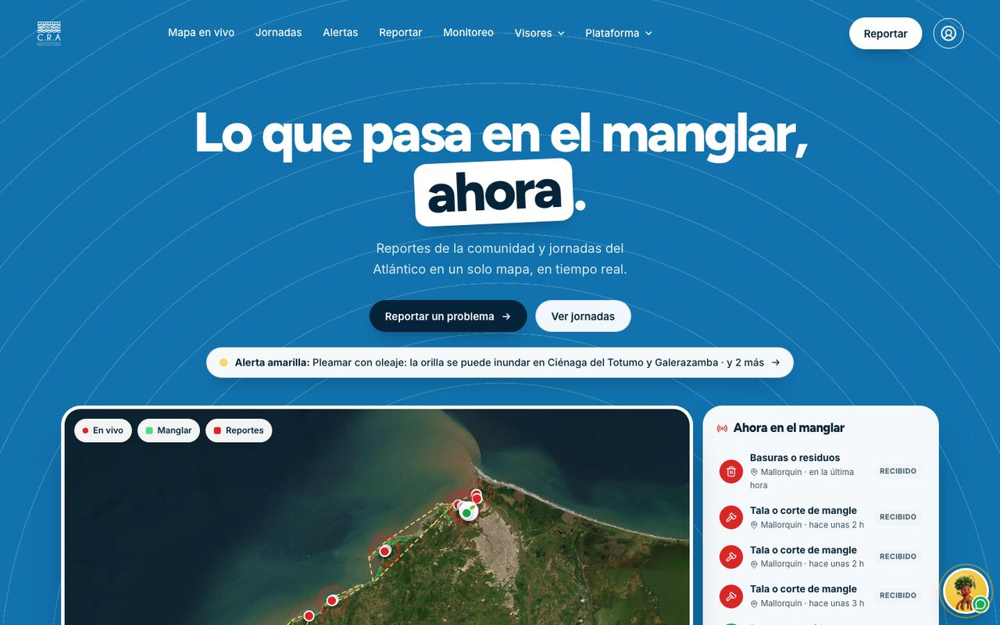

| Reportar desde la web | Alertas del manglar (IDEAM, DIMAR y C.R.A.) |
|---|---|
| 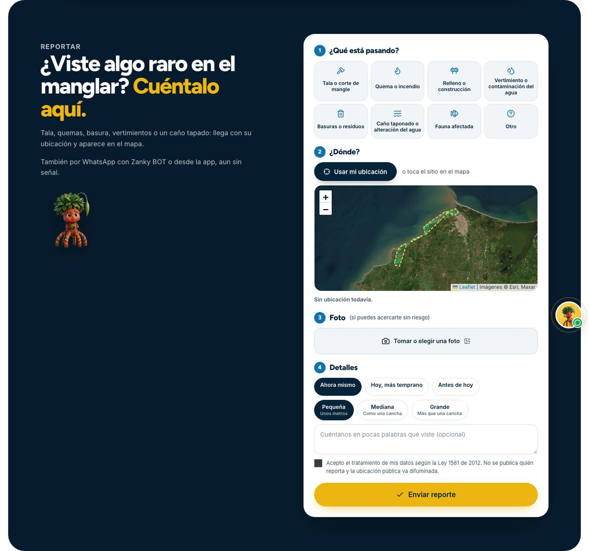 | 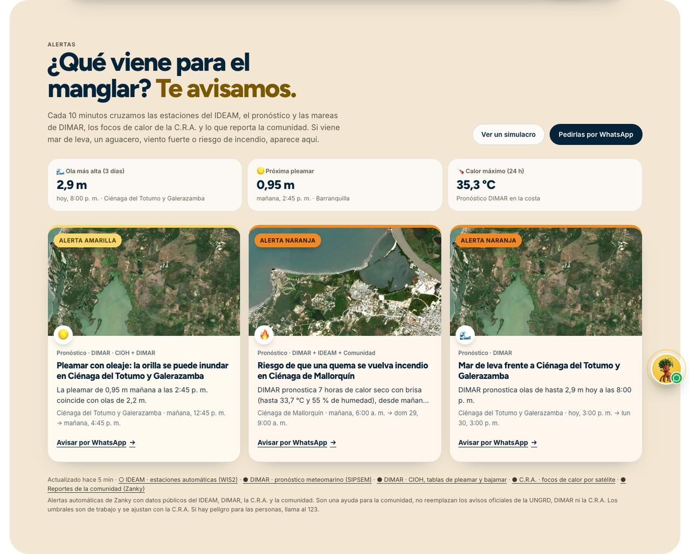 |

| Ficha de una jornada | Monitoreo comunitario con datos abiertos |
|---|---|
| 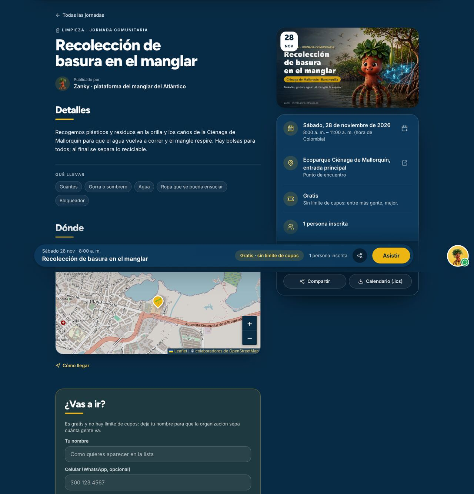 | 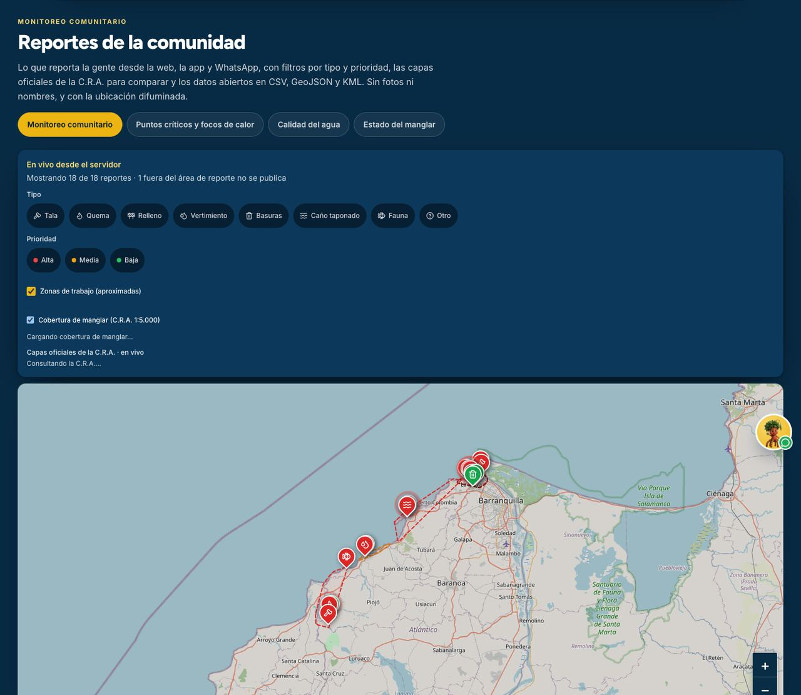 |

| Puntos críticos y focos de calor (API de la C.R.A.) | Calidad del agua de las ciénagas (ICA) |
|---|---|
| 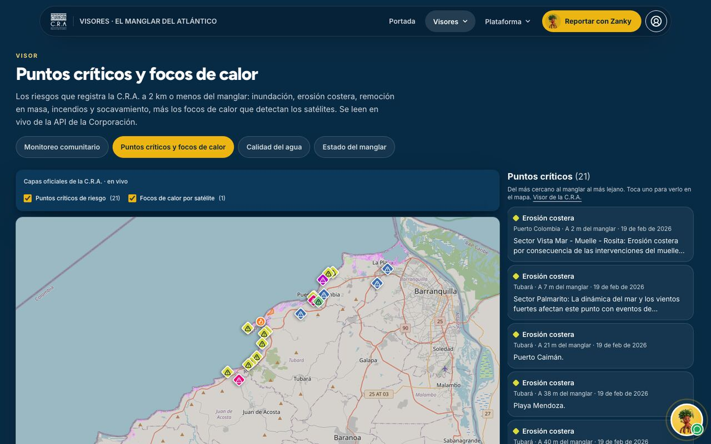 | 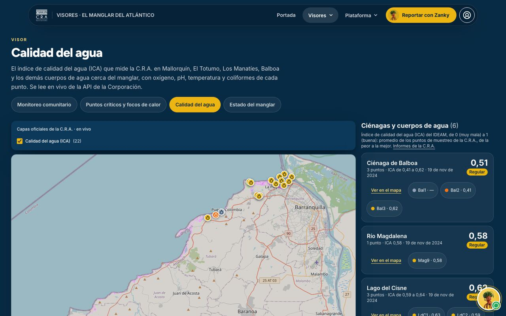 |

| Workflow del manglar de la C.R.A. | Plataforma abierta para la restauración |
|---|---|
| 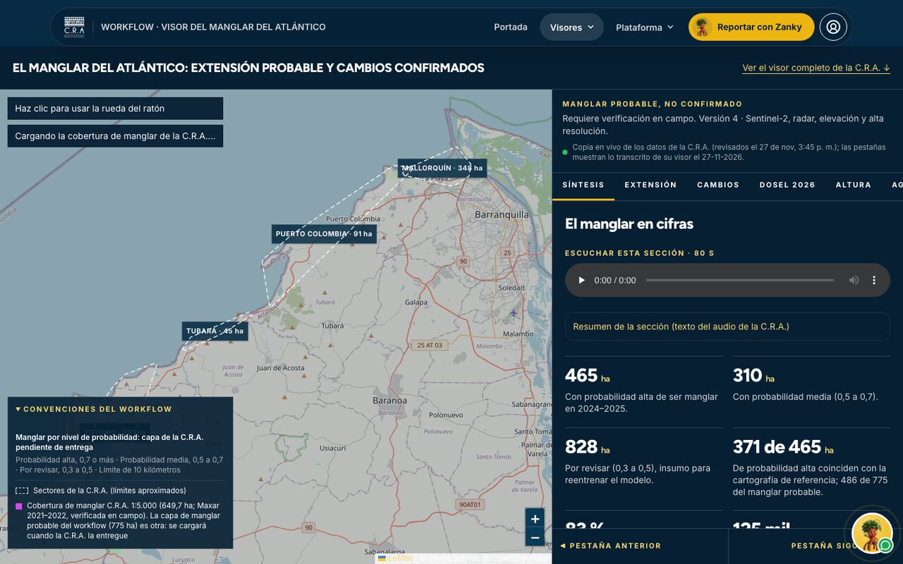 | 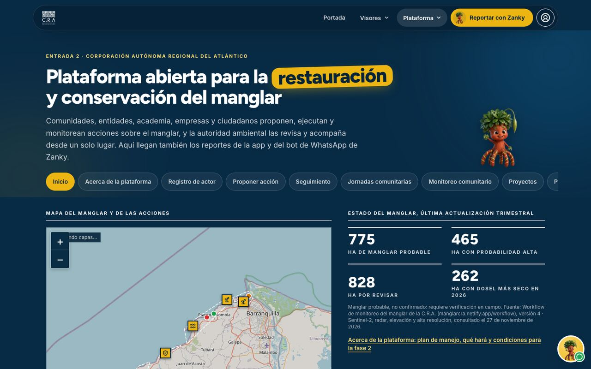 |

### Panel de la C.R.A. y administración

| Panel de la Corporación (acciones, reportes, auditoría) | Mapa de dónde salen los reportes (admin) |
|---|---|
| 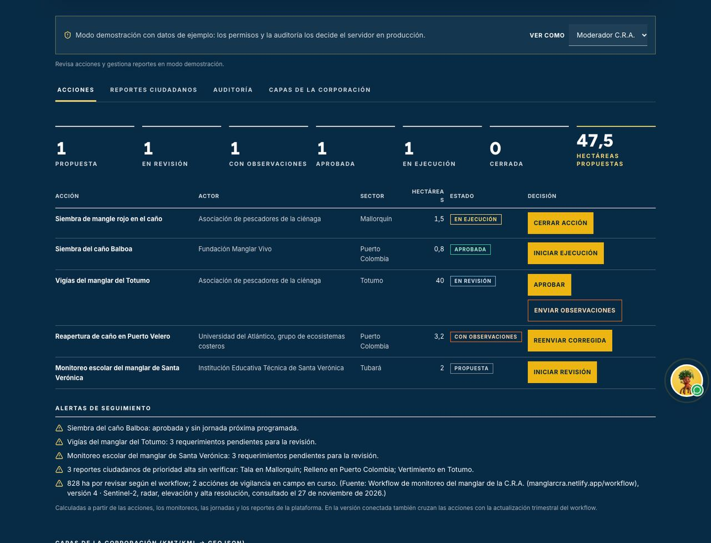 | 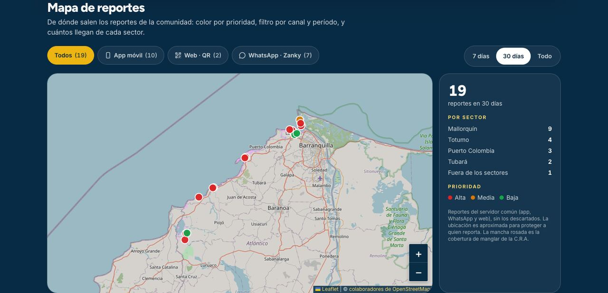 |

**«Por confirmar»** (admin): las publicaciones de la comunidad y los reportes esperan aquí a que el equipo los confirme. Los ejemplos que se ven están rotulados como **simulados**.

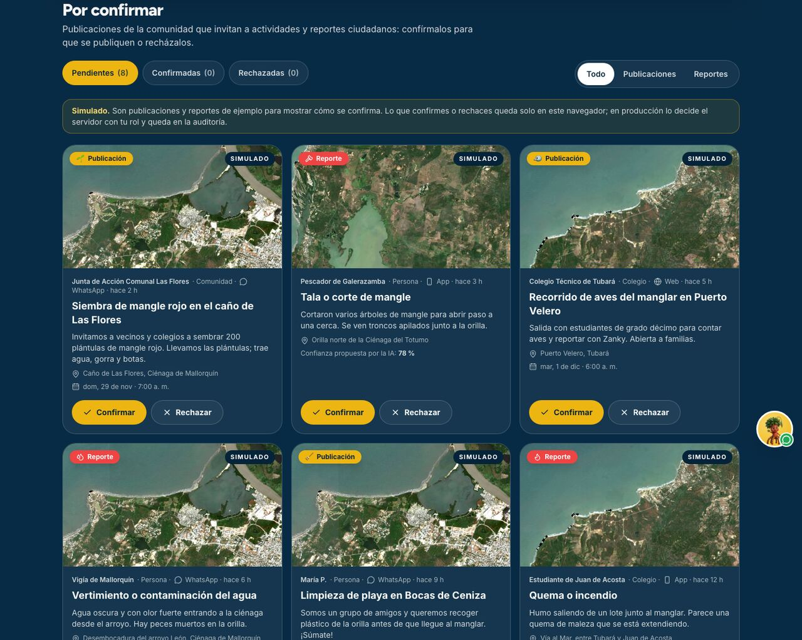

### App móvil (Flutter)

De izquierda a derecha: bienvenida, inicio, nuevo reporte (paso 2: dónde), mapa del manglar y tarjeta de guardián.

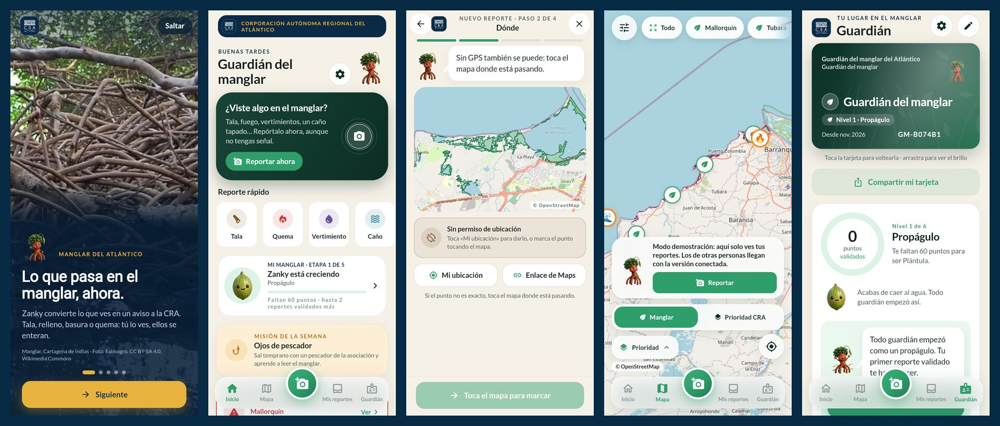

| Modo evento (lo que se abre con el QR de una jornada) | La web en el teléfono |
|---|---|
| 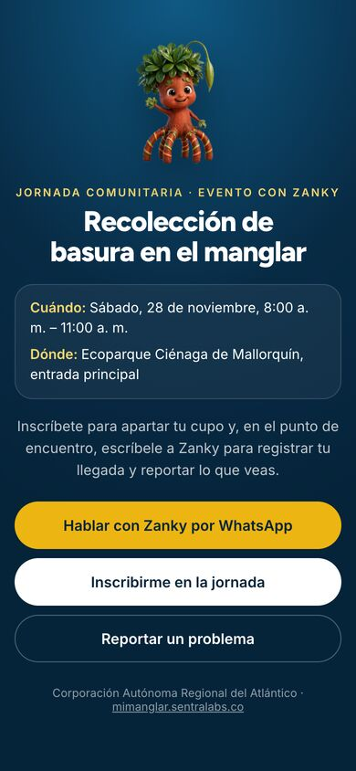 | 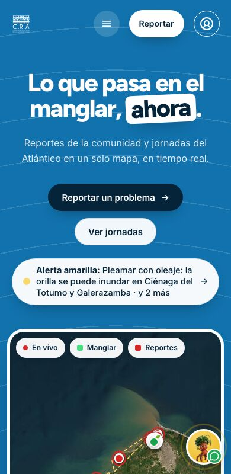 |

### Zanky BOT en WhatsApp

Para reportar una amenaza o inscribirse a una jornada sin instalar nada. La imagen es una **simulación**: está armada con los textos reales del bot (`bot/src/flujos/textos.ts`) y con las jornadas publicadas en el servidor, no es una captura de WhatsApp. El número de caso es de ejemplo.

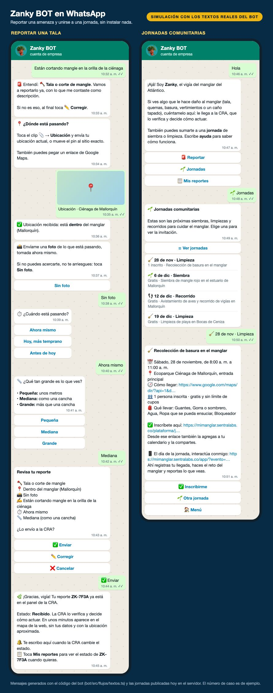

### Zanky, la mascota

Su nombre viene de los zancos del mangle rojo y de los zanqueros del Carnaval. Es el avatar del bot, la burbuja de la web y el guía de la app, y crece con los reportes validados: de propágulo a mangle rojo.

| Hoja de personaje | Stickers |
|---|---|
|  |  |

<p>
  
  
  
  
</p>

Más material en [marca/zanky/](marca/zanky/README.md).

## Cómo funciona

```
 App (Flutter, sin señal)  ┐
 WhatsApp (Zanky BOT)      ├──► Servidor común (Supabase: Postgres + PostGIS)
 Web (reportar)            ┘      · sector de la C.R.A. y área de influencia de 500 m
                                  · prioridad 1–5 y confianza 0–100
                                  · foto en almacenamiento privado
                                         │
              ┌──────────────────────────┼──────────────────────────┐
              ▼                          ▼                          ▼
   Panel de la C.R.A. y admin   Mapa público (cada 20 s)   Aviso al ciudadano por
   verificar, cambiar estado,   sin nombre ni foto,         WhatsApp cuando cambia
   auditoría                    ubicación difuminada,       el estado de su caso
                                datos abiertos CC BY 4.0
```

Las **alertas del manglar** corren en el servidor del bot cada 10 minutos. Cruzan las estaciones automáticas y el pronóstico del IDEAM, las mareas de DIMAR y los focos de calor de la C.R.A., y avisan de mar de leva, pleamar con oleaje, lluvia o viento fuerte y riesgo de incendio.

## Componentes

| Carpeta | Qué es | Estado hoy (27-11-2026) |
|---|---|---|
| `web/` | Web comunitaria, visores, plataforma de la C.R.A., panel y administración (Astro + React) | Publicada en mimanglar.sentralabs.co, conectada al servidor común |
| `app/` | App móvil Android (Flutter), también compilada para la web | Flujo completo de reporte con cola sin señal, mapa, mis reportes y guardián. Sin las claves del servidor corre en modo demostración y lo dice |
| `bot/` | Zanky BOT: WhatsApp Cloud API, alertas, jornadas y datos abiertos. Ver [bot/README.md](bot/README.md) | En línea con número propio, guarda en el servidor común |
| `backend/supabase/` | Esquema, reglas de zona, prioridad y confianza, permisos por rol, funciones | En uso por la web, la app y el bot. La clasificación de fotos con IA está escrita, pero todavía no se ha desplegado |
| `hardware/esp32-sensor/` y `tools/` | Estación ESP32 (nivel de agua, salinidad, temperatura) e ingesta de lecturas | En desarrollo |
| `datos/` | Cobertura de manglar de la C.R.A. a 1:5.000, capa de INVEMAR 2020 y prioridades | Referencia |
| `marca/` | Zanky: personaje, ánimos, materiales y escenas de video | Listo |
| `handoff/` | Documentación del equipo: reto, solución, datos, reglas y pitch | Ver [handoff/README.md](handoff/README.md) |

## Datos y fuentes

- **C.R.A.**: cobertura de manglar a 1:5.000; workflow del manglar (manglar probable, cambios 2016–2025 y dosel 2026), que se copia cada 15 minutos; API pública de gestión del riesgo (puntos críticos, focos de calor y calidad del agua) y noticias de crautonoma.gov.co.
- **IDEAM**: estaciones automáticas (WIS2) y pronóstico WRF y WW3. **DIMAR**: tablas de marea.
- **INVEMAR**: Capa Nacional de Manglares 2020, como referencia nacional.
- **Mapas base**: OpenStreetMap e imágenes de Esri.
- **Datos abiertos de Zanky**: reportes públicos en CSV, GeoJSON y KML con licencia **CC BY 4.0**. No llevan nombre, teléfono ni foto, y la ubicación va difuminada.

## Ficha técnica

Herramientas, versiones y modelos de IA usados: [docs/ficha-tecnica.md](docs/ficha-tecnica.md).

## Correrlo en local

```bash
cd web && npm ci && npm run dev        # http://localhost:4321 (sin web/.env queda en modo demostración)
cd bot && npm ci && npm run simular    # el bot en la terminal, sin WhatsApp
cd app && flutter run                  # la app en un teléfono o emulador Android
```

Las claves van en archivos `.env` que no se suben al repo (ver `bot/.env.example`).

---

Equipo **SENTRALABS · UTB** para la Corporación Autónoma Regional del Atlántico (C.R.A.).
